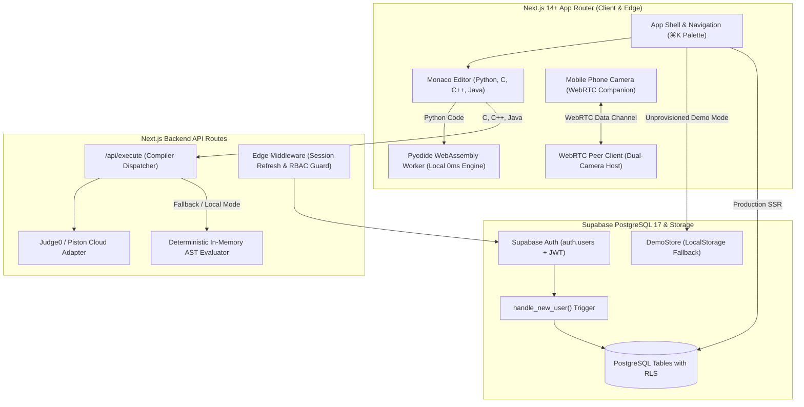

# DotCoder: Master End-to-End System, Product & Backend Architecture

> **Platform:** DotCoder — Enterprise Campus Placement, Coding Lab & AI-Proctored Assessment SaaS  
> **Visual Aesthetic:** Luxury Clean & Vibrant (Stripe / Supabase Studio / Apple Pro)  
> **Target Audience:** Engineering Students, College Training & Placement Officers (TPOs), Institutional Leadership (NAAC/NIRF), and Corporate Tech Recruiters (TCS, Zoho, Infosys, Cognizant).

---

## 1. Executive Product Overview & Value Proposition

DotCoder replaces legacy campus placement portals (Mettle, HackerEarth, Superset) with an integrated SaaS platform engineered to eliminate recurring cloud compute costs while maintaining institutional integrity:
1. **Zero-Cloud-Waste Coding Lab (DotLab):** In-browser execution of student code via **Pyodide WebAssembly (WASM)**, delivering instant execution feedback with zero server compute bills.
2. **Dual-Camera Proctoring Engine:** Dual-angle surveillance pairing the student's laptop webcam with a zero-install **WebRTC smartphone camera sync** via a dynamic QR code.
3. **Company-Specific Exam Simulator:** Replicates real corporate recruitment tests (TCS NQT, Zoho, Infosys) with locked sectional timers, negative marking (+1 / -0.25), formula scratchpads, and automated tier cutoffs (**Ninja** vs. **Digital Specialist**).
4. **End-to-End TPO Recruitment Funnel:** 5-stage recruitment Kanban (Applied → Test Shortlist → Tech Interview → HR Interview → Offer Extended), student CSV batch validator, and automated NAAC audit readiness reports.
5. **Recruiter-Ready ATS Resume:** 1-page placement portfolio embedded with verified DotCoder percentile badges and dynamic QR verification stamps.

---

## 2. Design System & Visual Grammar ("Luxury Clean & Vibrant")

* **Canvas & Surfaces:**
  * **App Background Canvas:** `#F8FAFC` (Slate-50) with subtle iridescent mesh gradients (`indigo-500/5` to `purple-500/5`).
  * **Card & Container Surfaces:** Pure `#FFFFFF` with razor-sharp sub-pixel borders (`border-slate-200/90`) and subtle elevation (`shadow-[0_1px_3px_rgba(0,0,0,0.03)]`).
  * **Code Canvas:** High-contrast Dark Monaco IDE (`vs-dark`, `#1E1E1E` or `#0F172A`) paired against crisp white specification panels.
* **Color Discipline (High-Signal Accents):**
  * **Primary Action / Brand:** Indigo-600 (`#4F46E5`) & Violet-600 (`#7C3AED`)
  * **Success / Qualified / Passed:** Emerald-600 (`#059669`) with Emerald-50 background pills
  * **Warning / Needs Practice:** Amber-600 (`#D97706`) with Amber-50 background pills
  * **Critical / At-Risk / Cheating Alert:** Rose-600 (`#E11D48`) with Rose-50 background pills
  * **Neutral Inks:** Slate-900 (`#0F172A` headlines), Slate-600 (`#475569` body), Slate-400 (`#94A3B8` captions/metadata).
* **Typography:**
  * **Display & Body:** Inter / Plus Jakarta Sans (`tracking-tight`, font weights: 500, 600, 700).
  * **Metrics, Code & Timers:** JetBrains Mono (`font-mono tabular-nums`).
* **Tactile Ergonomics & Micro-Interactions:**
  * **Page Transitions:** Magic UI Blur Fade / Framer Motion spring feedback (`active:scale-[0.98]`).
  * **Command Palette (`⌘K`):** Glassmorphic backdrop blur (`backdrop-blur-xl bg-white/90`).
  * **Shortcuts:** In-IDE quick keys (`⌘+Enter` to Run, `⌘+Shift+Enter` to Submit).

---

## 3. End-to-End System Architecture & Data Flow

---

## 4. Backend & Database Schema (Supabase PostgreSQL 17)

All tables enforce **PostgreSQL Row-Level Security (RLS)** with tenant isolation by college name.

### Core Tables & Relations

1. **`profiles` (1:1 with `auth.users`)**:
   * `id`: UUID (Primary Key, references `auth.users.id`)
   * `email`: TEXT
   * `full_name`: TEXT NOT NULL
   * `role`: TEXT CHECK IN (`'student'`, `'admin'`, `'super_admin'`, `'tpo'`)
   * `college_name`: TEXT (Default: `'Independent / General'`)
   * `roll_no`: TEXT
   * `department`: TEXT (`'CSE'`, `'IT'`, `'ECE'`, `'EEE'`, `'Mech'`)
   * `batch_year`: INT (`2026`)
   * `readiness_score`: NUMERIC(5, 2) (`0.00` to `100.00`)
   * `problems_solved`: INT
   * `created_at`: TIMESTAMPTZ

2. **`problems` (Coding Challenges & Aptitude Questions)**:
   * `id`: UUID (Primary Key)
   * `title`: TEXT NOT NULL
   * `slug`: TEXT UNIQUE NOT NULL
   * `difficulty`: TEXT (`'Easy'`, `'Medium'`, `'Hard'`)
   * `company_tags`: TEXT[] (e.g. `['TCS NQT', 'Zoho', 'Infosys']`)
   * `type`: TEXT (`'coding'` or `'mcq'`)
   * `description_md`: TEXT (Problem statement, I/O formats, constraints)
   * `starter_code_json`: JSONB (`{"python": "...", "java": "...", "cpp": "...", "c": "..."}`)
   * `mcq_options_json`: JSONB (For aptitude MCQs)
   * `correct_option`: TEXT / INT
   * `is_public`: BOOLEAN (Default: `true`)

3. **`test_cases` (Problem Unit Tests)**:
   * `id`: UUID (Primary Key)
   * `problem_id`: UUID (FK to `problems.id`)
   * `input`: TEXT (Stdin)
   * `expected_output`: TEXT (Expected Stdout)
   * `is_hidden`: BOOLEAN (Visible in sandbox vs. hidden in final evaluation)

4. **`assessments` (Proctored Campus Mock Tests)**:
   * `id`: UUID (Primary Key)
   * `title`: TEXT NOT NULL
   * `description`: TEXT
   * `target_college`: TEXT (`'ALL'` or specific college name)
   * `duration_minutes`: INT (e.g. `45`, `60`, `90`)
   * `is_proctored`: BOOLEAN (Lockdown, webcam, tab switch monitor)
   * `is_active`: BOOLEAN
   * `created_by`: UUID (FK to `profiles.id`)

5. **`submissions` (Evaluation Records)**:
   * `id`: UUID (Primary Key)
   * `user_id`: UUID (FK to `profiles.id`)
   * `problem_id`: UUID (FK to `problems.id`)
   * `assessment_id`: UUID (Nullable, FK to `assessments.id`)
   * `language`: TEXT (`'python'`, `'java'`, `'c'`, `'cpp'`)
   * `source_code`: TEXT
   * `status`: TEXT (`'Accepted'`, `'Wrong Answer'`, `'Time Limit Exceeded'`, `'Compilation Error'`)
   * `passed_cases`: INT, `total_cases`: INT, `score`: NUMERIC(5, 2)
   * `tab_switches`: INT (Proctoring anti-cheat counter)
   * `submitted_at`: TIMESTAMPTZ

6. **`campus_drives` (Recruitment Openings)**:
   * `id`: UUID (Primary Key)
   * `company_name`: TEXT, `role_title`: TEXT, `ctc_range`: TEXT (e.g. `₹7.0 - ₹11.5 LPA`)
   * `min_readiness_score`: NUMERIC(5, 2), `allowed_departments`: TEXT[], `max_backlogs`: INT
   * `status`: TEXT (`'Upcoming'`, `'Ongoing'`, `'Completed'`)

7. **`drive_applications` (5-Stage Kanban Funnel)**:
   * `id`: UUID (Primary Key)
   * `drive_id`: UUID (FK to `campus_drives.id`), `student_id`: UUID (FK to `profiles.id`)
   * `stage`: TEXT (`'Applied'`, `'Shortlisted for Test'`, `'Technical Interview'`, `'HR Interview'`, `'Offer Extended'`, `'Rejected'`)

---

## 5. Detailed User Flows & Screen Hierarchies

### Screen 1: Student Coding Lab (`/student/lab/[slug]`)
* **Top Toolbar (56px White Bar):**
  * Left: Return to Workspace arrow, Problem selector combobox, Difficulty pill (`Easy`/`Medium`/`Hard`).
  * Center: Execution runtime pill (`Pyodide WASM (Local)`).
  * Right: Language selector (`Python 3.10`, `Java 15`, `C++ 17`, `C 11`), Font size selector (`12px`, `13px`, `14px`), Reset Code button, `Run (⌘↵)` button, `Submit (⌘⇧↵)` gradient button.
* **Left Specification Pane (42% Width):**
  * Company badges (`Zoho`, `TCS NQT`), Category tag (`ARRAY • HASH MAP`).
  * Problem Statement in formatted markdown with syntax-highlighted code blocks.
  * Input/Output examples with copyable test case cards.
* **Right Coding Workspace (58% Width):**
  * Embedded Monaco IDE with file tab `solution.py`.
  * Bottom Dock Console: Tabs for `Test Cases`, `Custom Stdin`, and `Execution Trace` showing millisecond benchmarks and stdout vs. expected output diffs.

### Screen 2: Multi-Section Placement Simulator (`/student/exam/[id]/simulator`)
* **Sectional Navigation Rail:**
  * Section 1: Quantitative Aptitude (20 mins, locked)
  * Section 2: Logical Reasoning (20 mins, locked)
  * Section 3: Advanced Coding Round (20 mins, locked)
* **Corporate Test Header:**
  * Company Badge (`TCS NQT 2026 Corporate Standard`), Live Section Timer with countdown.
  * Negative marking pill (`+1.0 Correct / -0.25 Incorrect`).
* **Formula Scratchpad Drawer:** Slide-out mathematical cheat-sheet with common placement formulas (Permutations, Speed/Distance, Work/Time).
* **Automated Tier Cutoff Banner:** Live status determining qualification for **Ninja (₹3.6 - ₹4.5 LPA)** vs. **Digital Specialist (₹7.5 - ₹9.0 LPA)**.

### Screen 3: Proctored Exam Suite (`/student/exam/[id]`)
* **Lockdown Top Header:**
  * Full-width bar displaying exam title, student roll number (`22CS001`), `AI Proctor Active` shield icon, and countdown timer.
* **Question Matrix Palette (270px Left Rail):**
  * Grid of circular question badges colored by status (Green = Solved, Amber = Review, Blue = Current, Slate = Unvisited).
  * Anti-cheat status banner tracking tab switches and defocus events.
* **Question Pane:**
  * For MCQs: Clean radio card tiles (`A`, `B`, `C`, `D`) with hover illumination and instant response saving.
  * For Coding: Embedded Monaco IDE with hidden test case evaluation.
* **Anti-Cheat Modal Overlay:** High-contrast red alert modal triggered on `tab_switch`, `fullscreen_exit`, or `window.blur` warning of impending disqualification.

### Screen 4: Executive Analytics & TPO Command (`/admin/dashboard`)
* **4-Card Bento Metric Row:**
  1. *Total Candidates:* 15 students registered across monitored campuses.
  2. *Placement Ready:* 6 students (≥ 75% score, 40% conversion ratio).
  3. *Average Readiness:* 69% benchmark across quantitative and coding labs.
  4. *Integrity Violations:* 3 proctoring defocus alerts captured.
* **Branch Readiness Telemetry:** Segmented gradient progress meters displaying placement readiness across departments: CSE (67%), IT (67%), ECE (67%), EEE (0%), Mech (0%).
* **High-Density Candidate Leaderboard:** Filterable by department, tier (`Ready`, `Needs Practice`, `At-Risk`), and search query. Clicking "Details" opens the **Slide-Over Candidate Profile Drawer** showing individual violation logs and submission histories.

### Screen 5: Question Bank Repository (`/admin/problems`)
* **Active Question Bank Table:** Columns for Title, Slug, Difficulty, Company Tags, Test Cases count, and 1-click `Open IDE →` action.
* **Create New Problem Modal:**
  * Form inputs for Title, Slug, Difficulty dropdown, and comma-separated company tags.
  * Starter code templates tabs for Python, Java, C++, and C.
  * Interactive Assertion Test Cases Builder with input, expected output, and "Hidden" checkboxes.

### Screen 6: Assessments Manager (`/admin/assessments`)
* **Examinations Grid:**
  * Cards showing `AI Proctored` badge, duration, question count, and college targeting.
  * 1-click `Copy Exam Link` button with animated "Link Copied!" state feedback and `Preview Exam Room` button.
* **Assessment Scheduler Modal:** Configure duration, target campus batch, and lockdown security settings.

### Screen 7: Bulk Student Onboarding & CSV Validator (`/tpo/students`)
* **Drag-and-Drop Dropzone:** Dashed upload box supporting CSV drag-and-drop, sample template download, and a demo button `Load Test CSV with Validation Errors`.
* **Live Schema Validation Table:** Instant client-side parser checking required headers (`full_name`, `roll_no`, `department`, `email`, `batch_year`) and highlighting errors (invalid emails, duplicate roll numbers) with red error tags before committing valid records.

### Screen 8: Dual-Camera Mobile Sync (`/student/exam/[id]/companion`)
* **Desktop Pairing Screen:** Displays dynamic, rotating QR code containing encrypted WebRTC signaling data.
* **Mobile WebRTC Interface:** Smartphone opens lightweight, zero-install camera stream in portrait mode to monitor keyboard, desk, and room boundaries with live WebRTC connection indicators.

### Screen 9: Verified ATS Placement Resume (`/student/resume`)
* **Recruiter Portfolio Layout:**
  * Header with candidate name, branch, roll number, and verified DotCoder rating.
  * Readiness score radar, Top Solved Problems section with complexity metrics.
  * Authenticity verification badge with QR code linking directly to recruiter verification route.
  * High-contrast `@media print` CSS for 1-click clean PDF export.

### Screen 10: Platform Landing Page & Login Switcher (`/` & `/login`)
* **Landing Page:** Animated Magic UI GridPattern hero, partner marquee (Zoho, TCS, Infosys, Cognizant, Google), institutional reliability bento grid, and high-impact CTA buttons.
* **Auth & Role Switcher:** Split-screen authentication with 1-click demo switcher pills (**Adithya K. Sundaram (Student)** vs. **Dr. R. Ramanathan (TPO)**) for instant evaluator access without password entry.

---

## 6. Resilience & Zero-Crash Architecture

1. **Local Demo Mode (`DemoStore`):** If Supabase environment variables (`NEXT_PUBLIC_SUPABASE_URL`, `NEXT_PUBLIC_SUPABASE_ANON_KEY`) or external compiler API keys are unconfigured, the application runs seamlessly using reactive `localStorage` state with pre-seeded campus data.
2. **Deterministic Code Evaluator:** If external code execution APIs (Piston / Judge0) fail or experience rate limits, `/api/execute` falls back to an internal deterministic sandbox evaluator, guaranteeing UI flows never freeze or crash.
3. **Strict Type Safety:** Zero `any` types across all TypeScript components (`strict: true`), ensuring robust state transitions across all navigation routes.
