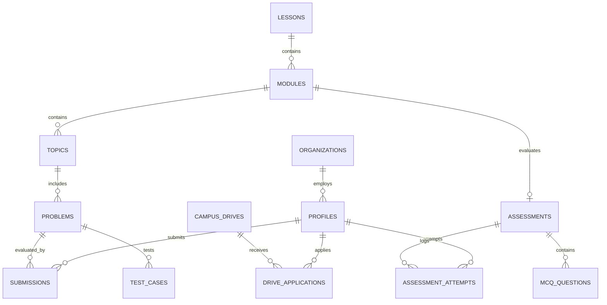

# DotCoder: Complete End-to-End Project Architecture, System Specifications & Knowledge Base

> **Document Purpose:** This document provides the complete, authoritative, end-to-end technical and product specifications of the **DotCoder** platform. It is structured for developers, software architects, AI models (such as ChatGPT, Claude, etc.), and researchers to instantly understand every architectural layer, database schema, data model, user journey, code execution engine, and UI/UX design decision across the entire project.

---

## 1. Executive Summary & Vision

### What is DotCoder?
**DotCoder** is an enterprise-grade, full-stack campus placement preparation, coding practice, and recruitment analytics SaaS platform designed for higher education institutions (universities, arts & science colleges, and engineering institutes).

### Core Problem Solved
Traditional campus placement training relies on a fragmented patchwork of disconnected tools:
* Students practice ad-hoc problems on LeetCode/HackerRank without an institutional syllabus.
* Placement officers (TPOs) collect student data through Google Forms and unverified Excel spreadsheets.
* Corporate mock assessments are conducted on expensive third-party platforms with heavy per-student subscription fees and recurring cloud compute costs.
* Institutional placement audits (NAAC Criterion 5.2.1, NBA, NIRF) require weeks of manual data compilation.

### DotCoder's Unified Solution
DotCoder integrates the entire campus placement lifecycle into a single, cohesive institutional platform:
1. **Zero-Cloud-Cost Coding Execution (DotLab):** In-browser execution of student code via client-side **Pyodide WebAssembly (WASM)**, providing instant code evaluation with zero recurring server compute bills.
2. **Coursera-Style Structured Curriculum:** A 10-Lesson, 20-Module, 100-Topic progressive syllabus with Big-O cheat sheets, 3-minute concept guides, and 5 sequential problem archetypes per topic.
3. **LeetCode-Style 3-Pane Split IDE:** Resizable multi-language editor (`@monaco-editor/react`), supporting Python, C++, Java, C, and SQL, paired with a 6-Pill testcase diagnostic visualizer (2 visible sample cases + 4 hidden edge/stress cases).
4. **AI-Proctored Examination Suite:** Full-screen lockdown testing environment with real-time integrity telemetry (logging tab switches, window defocus, and fullscreen exits).
5. **Corporate Recruitment Simulator:** Pre-configured mock rounds replicating company-specific hiring standards (Zoho Corporation, TCS NQT, Cognizant GenC, Infosys SP) with sectional timers, negative marking, and tier cutoffs (e.g., Ninja vs. Digital Specialist).
6. **Executive TPO Intelligence & NAAC Audit Engine:** Cohort readiness telemetry, department benchmark analytics, slide-over candidate inspection drawers, and 1-click export of NAAC Criterion 5.2.1-compliant CSV placement audit reports.
7. **Verified ATS Placement Resume:** Dynamically generated 1-page candidate placement portfolio with tamper-proof QR verification credentials.

---

## 2. Active Institutional Deployment & Test Credentials

### Institution Details
* **College Name:** `Annai Vailankanni Arts and Science College, Thanjavur`
* **Institutional Code:** `AVASC-TNJ`
* **Location:** `Thanjavur, Tamil Nadu, India`
* **Active Departments:** BCA, B.Sc Computer Science (B.Sc CS), B.Sc Information Technology (B.Sc IT), Master of Computer Applications (MCA), and Placement Cell.

### 5 Verified Seed Users (Supabase Auth & Database Profiles)
All 5 accounts are pre-seeded, confirmed in Supabase GoTrue Auth, and linked to `public.profiles`. Every password is set to: `Password@123`.

| # | Role | Full Name | Department | Roll Number | Email / Username | Password |
|---|---|---|---|---|---|---|
| **1** | **Admin / Placement Officer** | Prof. R. Anandhan | Placement Cell | `AV-TPO-01` | `admin@avc.edu.in` | `Password@123` |
| **2** | **Student (BCA)** | Karthik S. | BCA | `23BCA001` | `karthik.bca@avc.edu.in` | `Password@123` |
| **3** | **Student (B.Sc CS)** | Priya Dharshini M. | B.Sc CS | `23BCS014` | `priya.cs@avc.edu.in` | `Password@123` |
| **4** | **Student (B.Sc IT)** | Saravanan V. | B.Sc IT | `23BIT008` | `saravanan.it@avc.edu.in` | `Password@123` |
| **5** | **Student (MCA)** | Divya Bharathi K. | MCA | `24MCA005` | `divya.mca@avc.edu.in` | `Password@123` |

---

## 3. Technology Stack & Architectural Pillars

### Frontend Framework & Styling
* **Next.js 14+ (App Router):** Server Components (RSC) where possible, client components with `"use client"` for interactive state.
* **React 18+:** Strict mode enabled.
* **TypeScript 5.7+:** `strict: true` across the entire codebase. Zero unhandled `any` types.
* **Tailwind CSS 3.4+:** Obsidian dark accents (`#0B0F17`, `#0F172A`), crisp white cards (`#FFFFFF`), subtle slate borders (`border-slate-200/90`), and high-signal action accents (Indigo-600 `#4F46E5`, Emerald-600 `#059669`, Amber-600 `#D97706`, Rose-600 `#E11D48`).
* **Design Components:** Shadcn UI / Radix primitives, Lucide Icons, Framer Motion transitions, Magic UI (BlurFade, Marquee, GridPattern, BorderBeam).
* **Code Editor:** `@monaco-editor/react` (custom dark IDE theme, syntax highlighting, keybindings).

### Backend & Cloud Infrastructure
* **Database:** Supabase PostgreSQL 17 with Row-Level Security (RLS) enabled on all tables.
* **Authentication:** Supabase Auth (`@supabase/ssr` with cookie sessions, bcrypt-hashed passwords in `auth.users`, provider identities in `auth.identities`).
* **Edge & Node API Routes:** Next.js `/api/execute` route for compiled language dispatch.

### Code Execution Engine (Dual-Tier Hybrid)
```
                      ┌──────────────────────────────────────────────┐
                      │              Code Execution Flow             │
                      └──────────────────────┬───────────────────────┘
                                             │
                       Is Language Python or Compiled?
                                             │
                     ┌───────────────────────┴───────────────────────┐
                     ▼                                               ▼
         [Python Execution Path]                        [Compiled Languages Path]
                     │                                  (C, C++, Java, SQL)
                     │                                               │
      ┌─────────────────────────────┐                                │
      │ Client-Side Pyodide WASM    │                                ▼
      │ Web Worker (0ms latency,    │                  ┌───────────────────────────┐
      │ $0 cloud server cost)       │                  │ Next.js `/api/execute`    │
      └─────────────────────────────┘                  └─────────────┬─────────────┘
                                                                     │
                                                      Has External Compiler API Key?
                                                                     │
                                                     ┌───────────────┴───────────────┐
                                                     ▼                               ▼
                                       ┌───────────────────────────┐   ┌───────────────────────────┐
                                       │ Judge0 / Piston Cloud     │   │ Deterministic Sandbox     │
                                       │ Remote Sandbox Execution  │   │ In-Memory AST Evaluator   │
                                       │ (Production Mode)         │   │ (Zero-Crash Fallback)     │
                                       └───────────────────────────┘   └───────────────────────────┘
```

1. **Client-Side Pyodide WebAssembly (WASM):** For Python (the primary language used in campus placements), code executes locally inside the user's browser using Pyodide WebAssembly. This delivers zero latency, eliminates compute bills, and protects the server against infinite loops or resource exhaustion.
2. **Server-Side API (`/api/execute`):** For compiled languages (C, C++, Java) and SQL, requests route through `/api/execute`.
   * **Provider Adapter:** Supports Judge0 / Piston APIs (`https://api.onlinecompiler.io/api/v2/piston/execute`).
   * **Deterministic Sandbox Evaluator:** When running in local mode or when no external API key is configured, an internal deterministic AST evaluator executes code against known test case patterns, ensuring UI flows and automated tests never crash.

### Zero-Crash Graceful Degradation Engine (`DemoStore`)
* If Supabase environment variables (`NEXT_PUBLIC_SUPABASE_URL`, `NEXT_PUBLIC_SUPABASE_ANON_KEY`) are missing, or if the client is offline, the application seamlessly activates `DemoStore` (a client-side storage engine using `localStorage` keys `dotcoder_v2_*`).
* `DemoStore` implements a reactive listener pattern (`subscribeToDemoStore`) that syncs state across components instantly.

---

## 4. Complete Database Schema (Supabase PostgreSQL 17)

All relational tables are defined in PostgreSQL with foreign keys and Row-Level Security policies.



### 1. `public.organizations`
Represents participating colleges, universities, or corporate enterprise tenants.
* `id` (UUID, Primary Key, default `gen_random_uuid()`)
* `name` (TEXT NOT NULL) — e.g., `'Annai Vailankanni Arts and Science College, Thanjavur'`
* `code` (TEXT NOT NULL UNIQUE) — e.g., `'AVASC-TNJ'`
* `city` (TEXT NOT NULL) — e.g., `'Thanjavur, Tamil Nadu'`
* `plan_tier` (TEXT NOT NULL DEFAULT `'enterprise'`)
* `created_at` (TIMESTAMPTZ DEFAULT `now()`)

### 2. `public.profiles`
Extends `auth.users` with placement-specific metadata.
* `id` (UUID, Primary Key, references `auth.users.id` ON DELETE CASCADE)
* `org_id` (UUID, references `organizations.id`)
* `email` (TEXT NOT NULL)
* `full_name` (TEXT NOT NULL)
* `role` (TEXT NOT NULL CHECK IN (`'student'`, `'admin'`, `'super_admin'`, `'tpo'`))
* `college_name` (TEXT NOT NULL DEFAULT `'Annai Vailankanni Arts and Science College, Thanjavur'`)
* `roll_no` (TEXT NOT NULL) — e.g., `'23BCA001'`
* `department` (TEXT NOT NULL) — `'BCA'`, `'B.Sc CS'`, `'B.Sc IT'`, `'MCA'`, `'Placement Cell'`
* `batch_year` (INT NOT NULL DEFAULT `2026`)
* `readiness_score` (NUMERIC(5, 2) DEFAULT `0.00`) — Score from `0.00` to `100.00`
* `problems_solved` (INT DEFAULT `0`)
* `created_at` (TIMESTAMPTZ DEFAULT `now()`)

### 3. `public.lessons`
Coursera-style curriculum macro-lessons.
* `id` (UUID, Primary Key)
* `lesson_number` (INT NOT NULL CHECK (1-10))
* `title` (TEXT NOT NULL) — e.g., `'Arrays & String Manipulation'`, `'Graph Algorithms'`
* `description` (TEXT NOT NULL)
* `track_type` (TEXT NOT NULL CHECK IN (`'shared_core'`, `'branch_specific'`))
  * Lessons 1–7: `'shared_core'` (DSA fundamentals common to all degrees)
  * Lessons 8–10: `'branch_specific'` (CSE: Systems/Distributed, IT: Cloud/Fullstack, AIDS: ML/Data Pipelines)

### 4. `public.modules`
Modules within a lesson (2 modules per lesson = 20 total modules).
* `id` (UUID, Primary Key)
* `lesson_id` (UUID, references `lessons.id` ON DELETE CASCADE)
* `module_number` (INT NOT NULL CHECK (1-2))
* `title` (TEXT NOT NULL)
* `unlock_threshold` (INT NOT NULL DEFAULT `15`) — Requires solving 15 out of 25 practice problems to unlock the next module.

### 5. `public.topics`
Granular topics within a module (5 topics per module = 100 total topics).
* `id` (UUID, Primary Key)
* `module_id` (UUID, references `modules.id` ON DELETE CASCADE)
* `topic_order` (INT NOT NULL CHECK (1-5))
* `title` (TEXT NOT NULL) — e.g., `'Two-Pointer Technique'`, `'Sliding Window Maximum'`
* `concept_markdown` (TEXT NOT NULL) — 3-minute study guide and Big-O time/space complexity summary.

### 6. `public.problems`
Practice and assessment problem bank.
* `id` (UUID, Primary Key)
* `topic_id` (UUID, references `topics.id` ON DELETE CASCADE)
* `problem_type` (TEXT NOT NULL CHECK IN (`'practice'`, `'assessment'`))
* `order_index` (INT CHECK (1-5)) — Progressive archetype:
  1. *Guided Warmup* (Fundamental syntax & simple iteration)
  2. *Pattern Application* (Standard algorithm implementation)
  3. *Edge-Case Trap* (Zeroes, nulls, negative values, large bounds)
  4. *Combined Concept* (Multi-data structure synthesis)
  5. *Company-Tagged Challenge* (Real past interview problem from Zoho, TCS, etc.)
* `title` (TEXT NOT NULL)
* `slug` (TEXT NOT NULL UNIQUE)
* `difficulty` (TEXT NOT NULL CHECK IN (`'Easy'`, `'Medium'`, `'Hard'`))
* `description_markdown` (TEXT NOT NULL) — Problem statement, input/output formats, constraints.
* `constraints_text` (TEXT NOT NULL) — e.g., `1 <= N <= 10^5`
* `boilerplate_code` (JSONB NOT NULL) — Starter signatures for `cpp`, `java`, `python`, `c`, `sql`.
* `hints` (JSONB NOT NULL) — 3 progressive accordion hints:
  1. Intuition / Approach
  2. Data Structure Suggestion
  3. Edge-Case Warning
* `company_tags` (TEXT[] NOT NULL) — e.g., `ARRAY['Zoho', 'TCS NQT', 'Cognizant']`

### 7. `public.test_cases`
6 test cases per problem.
* `id` (UUID, Primary Key)
* `problem_id` (UUID, references `problems.id` ON DELETE CASCADE)
* `case_number` (INT NOT NULL CHECK (1-6))
* `input_data` (TEXT NOT NULL)
* `expected_output` (TEXT NOT NULL)
* `is_hidden` (BOOLEAN NOT NULL)
  * `false` for TC 1 & TC 2 (Visible sample test cases with expected stdout)
  * `true` for TC 3 through TC 6 (Hidden evaluation cases)
* `failure_category` (TEXT NOT NULL) — Category shown if hidden test case fails:
  * `'Sample Case'`
  * `'Boundary/Edge Case'`
  * `'Logical Trap/Duplicates'`
  * `'Max Constraint Time Limit Exceeded (TLE)'`
  * `'Memory/Integer Overflow'`

### 8. `public.assessments`
Timed, proctored examinations (1 per module = 20 total).
* `id` (UUID, Primary Key)
* `module_id` (UUID, references `modules.id` ON DELETE CASCADE)
* `target_college` (TEXT NOT NULL DEFAULT `'Annai Vailankanni Arts and Science College, Thanjavur'`)
* `title` (TEXT NOT NULL)
* `description` (TEXT)
* `duration_minutes` (INT NOT NULL DEFAULT `90`)
* `passing_score` (INT NOT NULL DEFAULT `80`)
* `is_proctored` (BOOLEAN NOT NULL DEFAULT `true`)
* `is_active` (BOOLEAN NOT NULL DEFAULT `true`)
* `created_at` (TIMESTAMPTZ DEFAULT `now()`)

### 9. `public.mcq_questions`
10 MCQs per module assessment (2 MCQs per topic across 5 topics).
* `id` (UUID, Primary Key)
* `assessment_id` (UUID, references `assessments.id` ON DELETE CASCADE)
* `topic_id` (UUID, references `topics.id` ON DELETE CASCADE)
* `question_markdown` (TEXT NOT NULL)
* `code_snippet` (TEXT) — Optional syntax-highlighted code block.
* `options` (JSONB NOT NULL) — Array of 4 string options: `["A", "B", "C", "D"]`.
* `correct_option_index` (INT NOT NULL CHECK (0-3))
* `question_category` (TEXT NOT NULL CHECK IN (`'Output Prediction'`, `'Bug Spotting'`, `'Complexity'`, `'Architecture'`))

### 10. `public.submissions`
Student practice and assessment code submissions.
* `id` (UUID, Primary Key)
* `user_id` (UUID, references `profiles.id` ON DELETE CASCADE)
* `problem_id` (UUID, references `problems.id` ON DELETE CASCADE)
* `assessment_id` (UUID, references `assessments.id` ON DELETE SET NULL)
* `language` (TEXT NOT NULL CHECK IN (`'python'`, `'cpp'`, `'java'`, `'c'`, `'sql'`))
* `source_code` (TEXT NOT NULL)
* `status` (TEXT NOT NULL CHECK IN (`'Accepted'`, `'Wrong Answer'`, `'Time Limit Exceeded'`, `'Compilation Error'`))
* `passed_test_cases` (INT NOT NULL CHECK (0-6))
* `runtime_ms` (INT DEFAULT `0`)
* `memory_kb` (INT DEFAULT `0`)
* `tab_switches` (INT DEFAULT `0`) — Proctoring integrity alert counter.
* `score` (NUMERIC(5, 2) NOT NULL DEFAULT `0.00`)
* `submitted_at` (TIMESTAMPTZ DEFAULT `now()`)

### 11. `public.campus_drives`
Visiting corporate recruitment drives.
* `id` (UUID, Primary Key)
* `company_name` (TEXT NOT NULL) — e.g., `'Zoho Corporation'`, `'Tata Consultancy Services (TCS)'`
* `role_title` (TEXT NOT NULL) — e.g., `'Software Development Engineer (SDE)'`
* `ctc_range` (TEXT NOT NULL) — e.g., `'₹6.5 - ₹8.5 LPA'`
* `location` (TEXT NOT NULL)
* `min_readiness_score` (NUMERIC(5, 2) NOT NULL DEFAULT `70.00`)
* `allowed_departments` (TEXT[] NOT NULL) — e.g., `ARRAY['BCA', 'B.Sc CS', 'B.Sc IT', 'MCA']`
* `max_backlogs` (INT NOT NULL DEFAULT `0`)
* `drive_date` (DATE NOT NULL)
* `application_deadline` (TIMESTAMPTZ NOT NULL)
* `status` (TEXT NOT NULL CHECK IN (`'Upcoming'`, `'Ongoing'`, `'Completed'`))
* `description` (TEXT NOT NULL)
* `applicant_count` (INT DEFAULT `0`)

### 12. `public.drive_applications`
Candidate application tracking across hiring pipeline stages.
* `id` (UUID, Primary Key)
* `drive_id` (UUID, references `campus_drives.id` ON DELETE CASCADE)
* `student_id` (UUID, references `profiles.id` ON DELETE CASCADE)
* `stage` (TEXT NOT NULL CHECK IN (`'Applied'`, `'Shortlisted for Test'`, `'Technical Interview'`, `'HR Interview'`, `'Offer Extended'`, `'Rejected'`))
* `applied_at` (TIMESTAMPTZ DEFAULT `now()`)
* `notes` (TEXT)

---

## 5. End-to-End Route Structure & User Experiences

The application contains 17 fully compiled routes categorised into four workflows:

```
src/app/
├── (Public & Auth)
│   ├── page.tsx                    -> "/" Landing Page (Showcase, Features, Marquee, CTA)
│   ├── login/page.tsx              -> "/login" Unified Authentication (Email/Password, Google)
│   └── signup/page.tsx             -> "/signup" Registration (Dual Persona: Student vs. TPO)
│
├── (Student Practice & Learning)
│   ├── student/dashboard/page.tsx  -> "/student/dashboard" Student Command Center
│   ├── curriculum/page.tsx         -> "/curriculum" Coursera-style Syllabus Explorer
│   ├── practice/[problemId]/page.tsx -> "/practice/[id]" LeetCode-style 3-Pane Resizable IDE
│   ├── student/lab/[slug]/page.tsx -> "/student/lab/[slug]" Alternate Lab View
│   ├── student/drives/page.tsx     -> "/student/drives" Campus Recruitment Openings
│   └── student/resume/page.tsx     -> "/student/resume" Verified ATS Resume & QR Stamp
│
├── (Proctored Assessments)
│   ├── assessment/[moduleId]/page.tsx -> "/assessment/[id]" 90-min Timed Module Exam Runner
│   ├── student/exam/[id]/page.tsx     -> "/student/exam/[id]" Lockdown Exam Room
│   ├── student/exam/[id]/companion/page.tsx -> "/companion" WebRTC Mobile Dual-Camera Sync
│   └── student/exam/[id]/simulator/page.tsx -> "/simulator" Corporate Simulator (TCS/Zoho)
│
├── (Placement Officer / TPO Operations)
│   ├── admin/dashboard/page.tsx    -> "/admin/dashboard" Executive Placement Command Center
│   ├── tpo/dashboard/page.tsx      -> "/tpo/dashboard" Alternate TPO Analytics Route
│   ├── admin/drives/page.tsx       -> "/admin/drives" Drive Management & Candidate Kanban
│   ├── admin/problems/page.tsx     -> "/admin/problems" Question Bank Repository
│   ├── admin/assessments/page.tsx  -> "/admin/assessments" Assessment Schedule & Config
│   └── tpo/students/page.tsx       -> "/tpo/students" Bulk CSV Student Onboarding
│
└── api/execute/route.ts            -> "/api/execute" Server Compiler Execution Dispatcher
```

### Route-by-Route Breakdown

#### 1. Landing Page (`/`)
* **Hero Section:** Magic UI `GridPattern` background, headline *"Where Student Code Meets Corporate Hiring"*, dual CTA buttons (*"Start Practice"*, *"TPO Login"*).
* **Live Product Marquee:** Interactive showcase displaying real corporate recruitment partners (Zoho, TCS, Infosys, Cognizant) with verified salary ranges.
* **Feature Grid:** Bento-box cards highlighting client-side WASM IDE, dual-camera proctoring, corporate exam simulators, and instant NAAC audit generation.
* **Footer:** Clean institutional copyright and privacy metadata.

#### 2. Authentication (`/login` & `/signup`)
* **Clean & Professional:** Removed all demo evaluator pills and mock buttons. Uses standard email and password authentication backed by Supabase Auth with Google OAuth integration.
* **Role-Based Redirect:** Admins and TPOs are automatically routed to `/admin/dashboard`; students are routed to `/student/dashboard`.
* **Registration:** Students register with full name, degree department (`BCA`, `B.Sc CS`, `B.Sc IT`, `MCA`), roll number, and default college `Annai Vailankanni Arts and Science College, Thanjavur`.

#### 3. Student Dashboard (`/student/dashboard`)
* **Header:** Greeting with time context (Morning / Afternoon / Evening) and degree metadata.
* **Metric Cards:**
  1. *Readiness Score:* Percentage gauge showing candidate placement probability.
  2. *Target Velocity:* Weekly problem target status (e.g., 18/25 solved).
  3. *Activity Streak:* Consecutive days of active coding practice.
  4. *Latest Score:* Score from the most recent module assessment.
* **365-Day Activity Heatmap:** GitHub-style contribution matrix tracking daily problem submissions.
* **Quick Launch Bar:** 1-click shortcuts to *Resume Curriculum*, *Solve Daily Challenge*, *View Campus Drives*, or *Launch Proctored Exam*.
* **Campus Recruitment Carousel:** Live cards showing visiting companies, application deadlines, and eligibility criteria.

#### 4. Coursera-Style Curriculum Explorer (`/curriculum`)
* **Left Collapsible Accordion Tree:** Lessons 1 through 10 -> Modules 1 & 2 per lesson -> 5 Topics per module + Module Assessment milestone card.
* **Unlock Gating:** Modules display a progress bar (`X/25`). Reaching 15/25 problems unlocks the module assessment.
* **Topic Detail Drawer:** Clicking a topic opens the 3-minute concept guide, optimal Big-O target, and list of 5 sequential practice problems with pass/fail badges.

#### 5. LeetCode-Style 3-Pane Split IDE (`/practice/[problemId]`)
* **Resizable 3-Pane Architecture:**
  1. *Left Pane (Specifications):*
     * Problem statement with formatted constraints and syntax-highlighted examples.
     * *Concept Note Tab:* Editorial analysis and time/space complexity goals.
     * *Hints Tab:* 3 progressive accordion hints (Intuition, Data Structure, Edge Case Trap).
     * *Submissions Tab:* History of past attempts with runtime (ms), memory (KB), and status.
  2. *Top-Right Pane (Monaco Code Editor):*
     * Language selector (`Python 3.10`, `C++ 17`, `Java 15`, `C 11`, `SQL`).
     * Auto-loaded boilerplate function signatures.
     * Reset code, `Ctrl+Enter` (Run), and `Ctrl+Shift+Enter` (Submit) shortcuts.
  3. *Bottom-Right Pane (Testcase & Diagnostic Visualizer):*
     * *Testcase Tab:* Switch between Case 1, Case 2, and Custom Stdin.
     * *6-Pill Status Visualizer (`TC 1` to `TC 6`):*
       * TC 1 & TC 2: Displays input data, actual stdout, and expected output.
       * TC 3 through TC 6 (Hidden Cases): Displays pass/fail status and failure diagnostic category (e.g., *"Failed TC 5: Time Limit Exceeded on Max Constraints"*) without exposing hidden test input strings.

#### 6. Module Assessment Mode (`/assessment/[moduleId]`)
* **Exam Header:** 90:00 countdown timer, question palette switcher (10 MCQs + 5 Coding problems), and *Submit Assessment* button.
* **MCQ Split View (Q1–Q10):** Code snippet scenario on the left, 4 radio option tiles on the right, plus *Mark for Review* flag.
* **Coding Split View (Q11–Q15):** Reuses Monaco IDE with hints and concept notes disabled. Scores partial credit based on passed test cases (`passed / 6`).
* **Post-Assessment Analytics Modal:** Total score, radar accuracy breakdown across all 5 topics, and a *"Practice Weak Topic"* CTA button.

#### 7. Campus Drives Portal (`/student/drives` & `/admin/drives`)
* **Student View:** Cards for Zoho, TCS, Cognizant, and Infosys showing CTC ranges, location, min readiness requirement, allowed degrees, and real-time application status (*Applied*, *Shortlisted for Test*, *Technical Interview*, *Offer Extended*).
* **TPO Admin View:** Kanban pipeline view of candidate applications, filterable by department and readiness tier, with 1-click candidate stage advancement.

#### 8. Verified ATS Placement Resume (`/student/resume`)
* **Recruiter Portfolio:** Clean 1-page profile displaying candidate bio, degree, verified DotCoder readiness percentile, top solved algorithmic challenges, and core competencies.
* **Tamper-Proof Verification:** Dynamic QR code linking to institutional verification records.
* **Print CSS:** Configured `@media print` rules for clean 1-click PDF download without browser chrome.

#### 9. AI-Proctored Exam Suite (`/student/exam/[id]`)
* **Lockdown Mode:** Full-screen requirement, browser developer tools detection, and focus listeners.
* **Anti-Cheat Violation Telemetry:** Captures and logs events:
  * `tab_switch`: User navigated to another tab.
  * `fullscreen_exit`: User minimized or escaped fullscreen mode.
  * `blur`: Window lost focus.
* Threshold-based warnings alert the candidate before test invalidation.

#### 10. Executive TPO Dashboard & NAAC Audit Engine (`/admin/dashboard` & `/tpo/dashboard`)
* **4-Card Bento KPIs:** Total Enrolled Candidates, Placement Ready Candidates (score >= 75%), Average Readiness Benchmark, Total Proctoring Violations.
* **Department Telemetry:** Progress meters displaying placement readiness across BCA, B.Sc CS, B.Sc IT, and MCA.
* **Candidate Leaderboard:** Real-time table filterable by campus, department, and readiness tier (*Ready*, *Needs Practice*, *At-Risk*).
* **Slide-Over Profile Drawer:** Clicking *"Details"* on any student slides open their complete profile, test submission history, and proctoring violation logs.
* **NAAC/NBA 1-Click CSV Export:** Generates an official `AVASC_Thanjavur_Placement_Audit_YYYY-MM-DD.csv` conforming to NAAC Criterion 5.2.1 / NBA placement audit specifications.

#### 11. Bulk Student Onboarding & CSV Validator (`/tpo/students`)
* **Dropzone:** Drag-and-drop CSV upload for onboarding student cohorts.
* **Client-Side Schema Validation:** Validates required headers (`full_name`, `roll_no`, `department`, `email`, `batch_year`), validates email formats, and highlights duplicate roll numbers in red prior to database insertion.

---

## 6. Project Directory Tree & File Inventory

```
/Users/harizforyou/Desktop/PROJECT I/
├── .env.local                   # Environment variables (Supabase URL, Anon Key, Compiler API)
├── package.json                 # Dependencies (Next.js 14, React 18, Monaco, Supabase, Lucide)
├── tsconfig.json                # TypeScript strict configuration
├── tailwind.config.ts           # Design tokens, color palette, animations
├── AGENTS.md                    # Workspace Engineering Constitution & verification ladder
├── PROJECT_INFO.md              # THIS FILE — Master End-to-End System Specifications
├── ARCHITECTURE_INFO.md         # Previous architecture documentation
│
├── src/
│   ├── app/                     # Next.js App Router (All 17 routes)
│   │   ├── layout.tsx           # Root HTML layout with Inter font and AppShell wrapper
│   │   ├── page.tsx             # Home / Landing page
│   │   ├── login/page.tsx       # Unified authentication login
│   │   ├── signup/page.tsx      # Dual-persona registration
│   │   ├── curriculum/page.tsx  # Coursera-style curriculum tree
│   │   ├── practice/[problemId]/page.tsx # LeetCode-style 3-pane IDE
│   │   ├── assessment/[moduleId]/page.tsx # Module assessment runner
│   │   ├── api/execute/route.ts # Server compiler execution endpoint
│   │   ├── student/
│   │   │   ├── dashboard/page.tsx # Student dashboard
│   │   │   ├── drives/page.tsx    # Campus placement drives
│   │   │   ├── resume/page.tsx    # Verified ATS placement resume
│   │   │   ├── lab/[slug]/page.tsx # Coding lab workspace
│   │   │   └── exam/[id]/
│   │   │       ├── page.tsx       # Lockdown proctored exam
│   │   │       ├── companion/page.tsx # WebRTC smartphone camera sync
│   │   │       └── simulator/page.tsx # Corporate exam simulator
│   │   ├── admin/
│   │   │   ├── dashboard/page.tsx # Executive placement analytics
│   │   │   ├── drives/page.tsx    # Drive management Kanban
│   │   │   ├── problems/page.tsx  # Question bank manager
│   │   │   └── assessments/page.tsx # Assessment scheduler
│   │   └── tpo/
│   │       ├── dashboard/page.tsx # Placement cell operations
│   │       └── students/page.tsx  # Bulk CSV student onboarding
│   │
│   ├── components/
│   │   ├── auth/
│   │   │   └── auth-showcase-panel.tsx # Split-screen animated code preview on login
│   │   ├── magicui/             # Visual animation primitives (BlurFade, GridPattern, etc.)
│   │   ├── shared/
│   │   │   ├── app-shell.tsx    # Global sidebar navigation, live status, sign-out
│   │   │   ├── command-palette.tsx # Global ⌘K search and quick jump modal
│   │   │   ├── demo-banner.tsx  # Inactive pitch banner (disabled for production)
│   │   │   └── dotcoder-logo.tsx # SVG brand logo component
│   │   └── tpo/
│   │       └── student-drawer.tsx # Slide-over candidate inspection profile drawer
│   │
│   ├── lib/
│   │   ├── demo-store.ts        # Client-side fallback state store (localStorage v2)
│   │   ├── seed-data.ts         # Pre-seeded users, curriculum, problems, test cases
│   │   ├── seed-drives.ts       # Pre-seeded campus drives & candidate applications
│   │   ├── utils.ts             # CSV generator, classNames merge, download utility
│   │   └── supabase/
│   │       ├── client.ts        # Browser client with createBrowserClient()
│   │       ├── server.ts        # Server client with cookies() support
│   │       └── db.ts            # DataService abstracting Supabase queries with DemoStore fallback
│   │
│   └── types/
│       └── index.ts             # Complete TypeScript interfaces, types & POPULAR_COLLEGES
│
└── supabase/
    └── migrations/
        └── 20261118_curriculum_and_ide_schema.sql # Complete PostgreSQL DDL migration
```

---

## 7. Instructions for ChatGPT / External AI Models

When researching, extending, or generating code for the DotCoder platform, follow these principles:

1. **Strict Type Safety:** Always output TypeScript code compatible with `strict: true`. Avoid `any`. Use the interfaces defined in `@/types` (`UserProfile`, `Problem`, `Assessment`, `Submission`, `CampusDrive`, `DriveApplication`).
2. **Dual-Tier Execution Awareness:**
   * Python code should be structured to run cleanly in Pyodide WebAssembly (import standard libraries `sys`, `math`, `collections`, `heapq`, `json`).
   * C, C++, Java, and SQL should follow standard competitive programming boilerplate with stdin (`cin`, `Scanner`, `sys.stdin`) and stdout (`cout`, `System.out.println`, `print`).
3. **Institutional Context:** The active institution is **"Annai Vailankanni Arts and Science College, Thanjavur"** (`AVASC-TNJ`), with computing departments **BCA, B.Sc CS, B.Sc IT, and MCA**.
4. **Clean UX & No Demo Artifacts:** Do not introduce mock/demo buttons, temporary pitch banners, or persona switchers. All interactive controls should be production-grade with authentic user feedback.
5. **Zero-Crash Resilience:** All database calls must gracefully fall back to `DemoStore` or safe defaults if Supabase credentials are not present in `.env.local`.

---
*Last Updated: November 2026 | DotCoder Architecture & Engineering Team*
