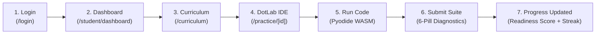
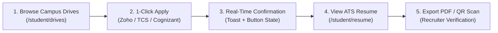
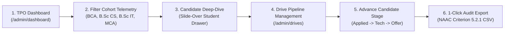

# DotCoder 2.0 — End-to-End User Journey Maps

> **Platform:** DotCoder 2.0 Enterprise SaaS  
> **Target Personas:** Candidate Student (`Karthik S.`), Head of Placement / Admin (`Prof. R. Anandhan`)  
> **Institution:** Annai Vailankanni Arts and Science College, Thanjavur  
> **Date:** November 2026

---

## 1. Journey Map 1: Student Daily Practice & Curriculum Progression

### Detailed Stage Breakdown

| Stage | User Action | System Response | Touchpoint / Component | UX Goal |
|---|---|---|---|---|
| **1. Authentication** | Enters `karthik.bca@avc.edu.in` and password | Validates via Supabase Auth / DemoStore, loads student profile | `src/app/login/page.tsx` | Sub-500ms entry; clear test credential guidance. |
| **2. Dashboard Triage** | Reviews readiness score (88%), streak (5 days), and next upcoming drive | Renders dynamic metric strip, 12-week activity heatmap | `src/app/student/dashboard/page.tsx` | Instant clarity on what to practice today. |
| **3. Curriculum Explorer** | Browses Module 3 (Data Structures), reviews 60% progress | Displays accordion hierarchy, 3-minute concept guide | `src/app/curriculum/page.tsx` | Coursera-style structured progressive guidance. |
| **4. Coding Practice** | Clicks "Continue Learning" on Two Sum | Loads resizable 3-pane IDE with Python boilerplate | `src/components/ide/split-pane-ide.tsx` | Zero-distraction dark developer canvas. |
| **5. Local Run** | Presses `⌘+Enter` to run code | Client Pyodide WASM executes sample cases in <10ms | `src/lib/pyodide-runner.ts` | Instantaneous feedback with zero server lag. |
| **6. Full Suite Submit** | Presses `⌘+Shift+Enter` to submit | Evaluates 2 public + 4 hidden stress cases, updates pills | `src/components/ide/split-pane-ide.tsx` | Clear diagnostic badge on edge-case failures. |
| **7. Progress Reflection** | Returns to dashboard or next problem | Problem marked solved, readiness score increments | `src/lib/curriculum-store.ts` | Gamified positive reinforcement. |

---

## 2. Journey Map 2: Proctored Assessment & Corporate Exam Simulator

```mermaid
flowchart LR
    A["1. Select Exam / Company<br/>(/student/simulator)"] --> B["2. Exam Brief & Rules<br/>(Section Timers, Proctoring)"]
    B --> C["3. Optional QR Pairing<br/>(Mobile Companion)"]
    C --> D["4. Section 1: Quantitative<br/>(+1.0 / -0.25 Mark)"]
    D --> E["5. Section 2: Logical & CS<br/>(Scratchpad Enabled)"]
    E --> F["6. Section 3: Coding Lab<br/>(Monaco Editor)"]
    F --> G["7. Benchmark Scorecard<br/>(Ninja vs Digital Tier)"]
```

### Detailed Stage Breakdown

| Stage | User Action | System Response | Touchpoint / Component | UX Goal |
|---|---|---|---|---|
| **1. Selection** | Selects corporate track (e.g. Zoho or TCS NQT) | Loads company test profile (3 sections, 90 mins) | `src/app/student/simulator/page.tsx` | Authentic recruitment test simulation. |
| **2. Briefing** | Reviews sectional lock rules and negative marking | Prepares candidate for time-bound constraints | `src/app/student/exam/[id]/simulator/page.tsx` | Clear expectations; zero surprises. |
| **3. Secondary Camera** | Scans QR code with smartphone camera | Connects mobile WebRTC video stream | `src/components/exam/mobile-sync-qr.tsx` | Institutional integrity without software install. |
| **4. Section 1 (Quant)** | Answers aptitude MCQs, opens formula scratchpad | Auto-saves answer, updates question palette | `src/components/exam/formula-scratchpad.tsx` | Fluid question jumping with review flags. |
| **5. Section 2 (Logic)** | Completes syllogisms & CS fundamentals questions | Enforces sectional countdown timer | `src/components/exam/mcq-runner.tsx` | Authentic TCS NQT sectional lock behavior. |
| **6. Section 3 (Coding)** | Solves 2 company-tagged programming challenges | Compiles and runs test assertions | Monaco Editor + Code Canvas | Rigorous hands-on coding evaluation. |
| **7. Final Scorecard** | Submits assessment | Calculates total score out of 20, awards cutoff tier | `src/app/student/exam/[id]/simulator/page.tsx` | Transparent placement profile benchmark. |

---

## 3. Journey Map 3: Campus Drives & Verified Placement Resume

### Detailed Stage Breakdown

| Stage | User Action | System Response | Touchpoint / Component | UX Goal |
|---|---|---|---|---|
| **1. Drive Discovery** | Reviews upcoming campus drives, eligibility criteria | Displays company cards, dates, CTC packages | `src/app/student/drives/page.tsx` | Complete transparency on campus hiring drives. |
| **2. 1-Click Apply** | Clicks "Apply Now" for Zoho Corporation | Persists application via `DataService.applyToCampusDrive()` | `src/app/student/drives/page.tsx` | Frictionless registration. |
| **3. Confirmation** | Receives confirmation toast, button transitions to `Applied ✓` | Syncs with TPO candidate pipeline | Toast notification + persistent state | Immediate assurance of successful registration. |
| **4. Resume Verification** | Navigates to `/student/resume` | Dynamically renders student credentials and 88% readiness | `src/app/student/resume/page.tsx` | ATS-compliant, verified placement credential. |
| **5. Recruiter Handshake** | Recruiter scans dynamic QR code on candidate resume | Authenticates student score on DotCoder registry | `src/app/student/resume/page.tsx` | Tamper-proof institutional credibility. |

---

## 4. Journey Map 4: Placement Officer (TPO) Institutional Leadership

### Detailed Stage Breakdown

| Stage | User Action | System Response | Touchpoint / Component | UX Goal |
|---|---|---|---|---|
| **1. Executive Review** | Reviews college-wide placement readiness (88%) | Renders aggregate KPIs, active colleges | `src/app/admin/dashboard/page.tsx` | Institutional oversight at a glance. |
| **2. Department Drill-Down**| Filters by department (BCA, B.Sc CS, B.Sc IT, MCA) | Updates student table, average readiness scores | Filter dropdowns | Identify at-risk cohorts early. |
| **3. Candidate Inspection** | Clicks Eye icon on student row | Opens slide-over drawer with detailed submission logs | `src/components/tpo/student-drawer.tsx` | Detailed candidate telemetry without leaving page. |
| **4. Pipeline Operations** | Navigates to `/admin/drives` | Displays active recruitment funnel across all companies | `src/app/admin/drives/page.tsx` | Centralized campus placement command center. |
| **5. Stage Advancement** | Advances candidate from "Applied" to "Technical Interview" | Updates application state, recalculates funnel metrics | `src/app/admin/drives/page.tsx` | Seamless recruiter coordination. |
| **6. Compliance Export** | Clicks "Export NAAC CSV" | Generates formatted CSV compliant with Criterion 5.2.1 | `src/lib/utils.ts` | Eliminates weeks of manual accreditation work. |
